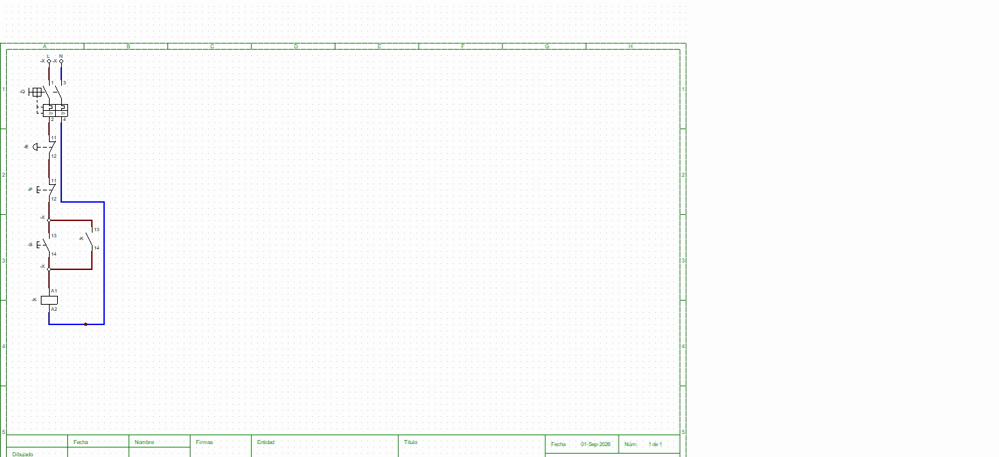
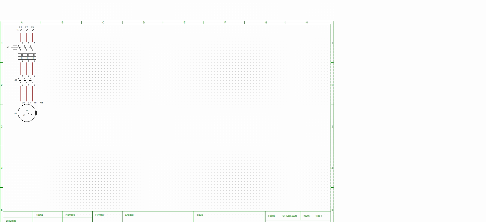

# Automatización de Máquinas

Lógica de mando y control de la máquina: arranque directo de un motor trifásico con enclavamiento, mediante contactor comandado por pulsadores de marcha y paro, más protección térmica.

## Topográficos nuevos (noviembre 2026)

El equipo rehizo el automatismo en dos topográficos de CADe SIMU, en `esquemas/`:

| Archivo | Motor | Componentes |
|---|---|---|
| `topograficoMonofasico.cad` (imagen `automatismo_monofasico.png`) | Monofásico (U1, V1, PE) | Q1, Q2, KM1, F1, S1 parada, S2 marcha, H1, bornera X |
| `topograficoTrifasico.cad` (imagen `automatismo_trifasico.png`) | Trifásico (U1, V1, W1, PE) | Q1, Q2, KM1, F1, S1 parada, S2 marcha, H1, bornera X |

Los dos son un arranque directo con autorretención: S2 energiza KM1, su contacto auxiliar lo mantiene, S1 lo corta y F1 (95-96) abre el mando si el motor se sobrecarga.

## Versión anterior (referencia)

La primera versión del equipo (`Automatismo.cad` y `Topografico.cad`) ya no está en esta carpeta: la reemplazan los dos topográficos de arriba. Sus capturas quedan en `referencias/fotos/`:

- Circuito de mando: Q2 (protección del mando) → F1 95-96 (térmico) → S1 parada (NC) → S2 marcha (NA) en paralelo con KM1 13-14 (autorretención) → bobina KM1 (A1-A2).
- Circuito de potencia: Q1 (guardamotor, 3 polos) → KM1 (contactos principales) → motor (U1, V1, W1, PE).

